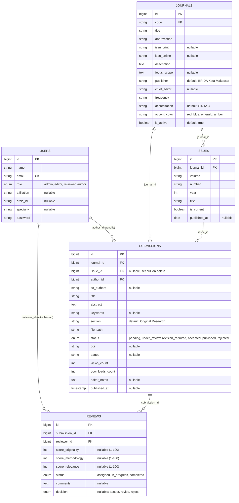
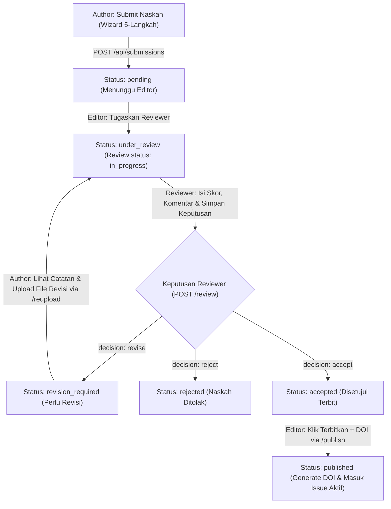

# DOKUMENTASI & KONTEKS LENGKAP PROYEK: OJS MULTI-JOURNAL BRIDA KOTA MAKASSAR

> **Tujuan Dokumen Ini**: File ini berisi seluruh spesifikasi teknis, arsitektur, skema basis data, alur bisnis, fitur antarmuka, daftar endpoint API, serta aturan kerja proyek **Portal OJS Multi-Journal BRIDA Kota Makassar**.
> Jika Anda memulai **New Conversation** di Gemini (atau AI coding assistant lainnya seperti ChatGPT, Claude, Cursor, Copilot), cukup unggah/lampirkan atau arahkan AI tersebut untuk membaca file ini (`C:\ojs brida\PROJECT_CONTEXT_FOR_AI.md`) agar AI langsung memahami 100% konteks proyek secara akurat.

---

## ⚡ 1. Ringkasan Prompt Siap Pakai (Copy-Paste untuk New Conversation)

Jika Anda ingin memulai chat baru dan tidak mengunggah file, Anda bisa menyalin ringkasan berikut ke prompt pertama chat baru Anda:

```text
Saya sedang mengerjakan proyek "Sistem Inovasi Portal OJS Multi-Journal BRIDA Kota Makassar" di folder "C:\ojs brida".
Tolong baca file konteks lengkap proyek di "C:\ojs brida\PROJECT_CONTEXT_FOR_AI.md" terlebih dahulu agar kamu memahami seluruh arsitektur, database, API, desain UI, alur peer-review, serta perbaikan-perbaikan terbaru yang sudah dilakukan.

Ringkasan cepat:
- Backend: Laravel 9 REST API (C:\ojs brida\backend-ojs, PHP ^8.0 via C:\xampp\php\php.exe, port 8000, host 0.0.0.0)
- Frontend: React 19 + Vite 8.3 + Tailwind CSS v4 (C:\ojs brida\frontend-ojs, port 5173, host 0.0.0.0, API URL dinamis via window.location.hostname)
- Database: MySQL XAMPP (C:\xampp\mysql\bin\mysqld.exe), DB_DATABASE=ojs_brida
- Multi-Jurnal aktif: J-SINTESA (SINTA 2), MJSC (SINTA 2), JEKMS (SINTA 3), JUHCR (SINTA 3)
- Alur Status Naskah: pending -> under_review -> revision_required -> accepted -> published (atau rejected)
- Launcher satu klik (support akses 1 Wi-Fi): C:\ojs brida\START_OJS_BRIDA.bat
```

---

## 🏛️ 2. Identitas & Latar Belakang Proyek

- **Nama Sistem**: Portal OJS Multi-Journal BRIDA Kota Makassar (*Open Journal Systems*)
- **Instansi**: Badan Riset dan Inovasi Daerah (BRIDA) Kota Makassar berkolaborasi dengan Universitas Hasanuddin (UNHAS).
- **Tujuan Utama**:
  1. Menyediakan satu portal terintegrasi (*Multi-Journal Portal*) yang menaungi berbagai jurnal ilmiah resmi BRIDA Kota Makassar beserta pengelolaannya dalam satu aplikasi.
  2. Menggantikan tampilan OJS klasik dengan antarmuka modern yang tetap mempertahankan alur kerja standar penerbitan ilmiah OJS (Submission, Editorial Screening, Double-Blind Peer Review, Revision Loop, dan Publication + DOI).
  3. Menerapkan arsitektur terpisah (*decoupled SPA + REST API*) dengan validasi input, sanitasi berkas unggahan (PDF/DOC/DOCX max 20 MB), serta pembatasan hak akses berbasis peran (*Role-Based Access Control / RBAC*).
  4. Mengadopsi desain visual akademis BRIDA (nuansa sky-blue hingga academic navy `#153e75`, frosted glass UI, ilustrasi buku 3D di hero portal, halaman login split-card bernuansa buku catatan, dan stepper 5-langkah pada form unggah naskah).

---

## 🛠️ 3. Arsitektur & Tech Stack Aktual

### A. Backend (REST API)
- **Lokasi**: `C:\ojs brida\backend-ojs`
- **Framework**: Laravel `^9.0` (`laravel/framework: ^9.0`)
- **Runtime PHP**: PHP `^8.0` — **Wajib menggunakan binary XAMPP**: `C:\xampp\php\php.exe`
- **Package Utama (`composer.json`)**:
  - `fruitcake/laravel-cors: ^2.0.5` (`allowed_origins => ['*']` di `config/cors.php`)
  - `laravel/sanctum: ^2.14`
  - `guzzlehttp/guzzle: ^7.2`
- **Penyimpanan Berkas**: Laravel `public` disk (`storage/app/public/submissions/`), diakses via `/storage/submissions/...`.
- **Port & Host**: `0.0.0.0:8000` (agar bisa diakses dari perangkat lain dalam jaringan Wi-Fi yang sama).

### B. Frontend (Single Page Application)
- **Lokasi**: `C:\ojs brida\frontend-ojs`
- **Library & Versi (`package.json`)**:
  - `react` & `react-dom`: `^19.2.8`
  - `vite`: `^8.3.0` & `@vitejs/plugin-react`: `^6.1.1`
  - `tailwindcss` & `@tailwindcss/vite`: `^4.3.3`
  - `axios`: `^1.20.0`
  - `lucide-react`: `^1.52.0` (ikon antarmuka)
  - `recharts`: `^3.10.1` (grafik PieChart & BarChart analitik)
  - `react-hot-toast`: `^2.6.1` (notifikasi toast)
  - `react-router-dom`: `^7.18.4`
- **Konfigurasi Server (`vite.config.js`)**:
  - `server.host: '0.0.0.0'`, `server.port: 5173`, `server.strictPort: true`.
- **Deteksi Alamat API Dinamis (`src/Dashboard.jsx`)**:
  ```javascript
  const API_HOST = typeof window !== 'undefined' ? window.location.hostname : '127.0.0.1';
  const API_BASE = `http://${API_HOST}:8000/api`;
  const STORAGE_BASE = `http://${API_HOST}:8000/storage/`;
  ```
  Dengan ini, ketika aplikasi dibuka lewat `localhost:5173` maupun lewat IP Wi-Fi (misal `http://192.168.1.31:5173` dari laptop lain/HP), frontend otomatis menembak backend API di host yang sama pada port `8000`.

### C. Database
- **DBMS**: MySQL / MariaDB via XAMPP (`C:\xampp\mysql\bin\mysqld.exe`)
- **Konfigurasi (`.env`)**:
  - `DB_CONNECTION=mysql`
  - `DB_HOST=127.0.0.1`
  - `DB_PORT=3306`
  - `DB_DATABASE=ojs_brida`
  - `DB_USERNAME=root`
  - `DB_PASSWORD=` (kosong)

---

## 📁 4. Struktur Direktori & File Kunci

```text
C:\ojs brida\
├── START_OJS_BRIDA.bat                # Launcher 1-klik: nyalakan MySQL, Laravel (0.0.0.0:8000), Vite (0.0.0.0:5173)
├── PROJECT_CONTEXT_FOR_AI.md          # File dokumentasi konteks ini
├── progres presentasi.pdf             # Dokumen referensi desain visual UI
├── backend-ojs\
│   ├── .env                           # Konfigurasi DB MySQL (ojs_brida)
│   ├── composer.json                  # Dependensi Laravel 9
│   ├── routes\api.php                 # Seluruh 18 endpoint REST API
│   ├── config\cors.php                # Konfigurasi CORS (allowed_origins: *)
│   ├── app\Http\Controllers\
│   │   └── SubmissionController.php   # Controller utama (Jurnal, Issue, Submission, Review, Stats, User)
│   ├── app\Models\
│   │   ├── User.php
│   │   ├── Journal.php
│   │   ├── Issue.php
│   │   ├── Submission.php
│   │   └── Review.php
│   └── database\
│       ├── migrations\
│       │   ├── 2014_10_12_000000_create_users_table.php
│       │   ├── 2024_01_01_000001_create_submissions_table.php  # Tabel journals, issues, submissions
│       │   └── 2024_01_01_000002_create_reviews_table.php      # Tabel reviews
│       └── seeders\
│           └── DatabaseSeeder.php     # Auto-seed 7 user, 4 jurnal, issues, naskah + file PDF valid otomatis
└── frontend-ojs\
    ├── package.json
    ├── vite.config.js                 # Vite server bound ke 0.0.0.0:5173
    ├── public\assets\                 # Aset gambar UI (brida-logo.png, hero-books.png, login-bg.png, login-notebook.png, dll)
    └── src\
        ├── App.jsx                    # State login, role aktif, & routing view Login vs Dashboard
        ├── Login.jsx                  # Halaman login split-card + pemilihan akun demo + akses Portal Publik tanpa login
        ├── Dashboard.jsx              # Komponen utama aplikasi (5 Tab + 3 Modal + Role Switcher)
        ├── App.css & index.css
        └── main.jsx
```

---

## 🗄️ 5. Skema Basis Data Relasional (ERD)

Seluruh tabel menggunakan relasi foreign key dengan `onDelete('cascade')` (kecuali `submissions.issue_id` yang memakai `onDelete('set null')`).



> **Catatan Seeder Otomatis (`ensureSeeded()`)**: Pada `SubmissionController.php`, jika tabel `journals` kosong (`Journal::count() === 0`), controller otomatis memanggil `DatabaseSeeder`. Seeder ini juga membuat file PDF nyata (`%PDF-1.4`) di `storage/app/public/submissions/` agar artikel sampel langsung dapat dibuka di browser.

---

## 📚 6. Data Seeded: 4 Jurnal & 7 Akun Pengguna

### A. 4 Jurnal Resmi di Portal BRIDA (`DatabaseSeeder.php`)
1. **Jurnal Inovasi dan Riset Daerah (J-SINTESA)**
   - Kode: `sintesa` | Singkatan: `J-SINTESA` | Akreditasi: **SINTA 2**
   - P-ISSN / E-ISSN: `2798-112X` / `2798-1138` | Ketua Redaksi: Dr. Ir. H. Andi Syahrul, M.Si.
2. **Makassar Journal of Smart City & Digital Security (MJSC)**
   - Kode: `smartcity` | Singkatan: `MJSC` | Akreditasi: **SINTA 2**
   - P-ISSN / E-ISSN: `2801-4412` / `2801-4420` | Ketua Redaksi: Prof. Dr. Eng. Azwan Alghifari, M.T.
3. **Jurnal Ekonomi Kreatif, Maritim & Sosial Humaniora (JEKMS)**
   - Kode: `maritim` | Singkatan: `JEKMS` | Akreditasi: **SINTA 3**
   - P-ISSN / E-ISSN: `2810-8819` / `2810-8827` | Ketua Redaksi: Dr. Baso Rafiansyah, S.Sos., M.A.P.
4. **Journal of Urban Health & Climate Resilience (JUHCR)**
   - Kode: `kesehatan` | Singkatan: `JUHCR` | Akreditasi: **SINTA 3**
   - P-ISSN / E-ISSN: `2822-3011` / `2822-302X` | Ketua Redaksi: Dr. dr. Siti Nurhaliza, M.Kes.

### B. Pengguna Seeded (`users`) & Role Switcher
Di `Login.jsx` terdapat 3 pilihan login cepat (*demo accounts*) dan di `Dashboard.jsx` terdapat **Role Switcher** di header atas untuk simulasi pergantian peran secara instan:

| Role | Nama | Email | Keterangan |
| :--- | :--- | :--- | :--- |
| `admin` | Dr. Ir. H. Andi Syahrul, M.Si. | `admin@brida.go.id` | Kepala Dewan Redaksi — BRIDA Kota Makassar |
| `editor` | Muh Fadhil Alrifa Saputra, S.Kom. | `editor@brida.go.id` | Pengelola Jurnal BRIDA (seeded di DB) |
| `reviewer` | Prof. Dr. Eng. Azwan Alghifari, M.T. | `reviewer@brida.go.id` | Departemen Teknik Informatika UNHAS (Reviewer utama di Role Switcher) |
| `reviewer` | Dr. Baso Rafiansyah, S.Sos., M.A.P. | `baso.reviewer@unhas.ac.id` | FISIP UNHAS (Reviewer 2 di dropdown penugasan) |
| `reviewer` | Dr. dr. Siti Nurhaliza, M.Kes. | `siti.reviewer@unhas.ac.id` | FKM UNHAS (Reviewer 3 di dropdown penugasan) |
| `author` | Balanza Aryandi Datu Hari Putra | `author@brida.com` | Peneliti — UNHAS (Author utama di Login/Role Switcher) |
| `author` | Ir. Rina Kartika, M.P.W.K. | `rina@bappeda.makassar.go.id` | Bappeda Kota Makassar (seeded di DB) |

---

## 🖥️ 7. Struktur Antarmuka (UI/UX), RBAC & Fitur Lengkap

### A. Halaman Login (`Login.jsx`)
- Header frosted glass dengan logo BRIDA dan tombol **"Jelajahi Portal Publik (Tanpa Login)"** (langsung masuk ke Tab `portal`).
- Kartu split 2 kolom:
  - Kiri: Ilustrasi latar langit + buku catatan & pena (`/assets/login-bg.png`, `/assets/login-notebook.png`) bertuliskan *"Start your journey"*.
  - Kanan: Pilihan role demo (Admin, Reviewer, Author), form email/password, checkbox mockup reCAPTCHA, mode tab `Login` / `Register`.

### B. Halaman Utama (`Dashboard.jsx`) — 5 Tab + 3 Modal

#### Hak Akses Tab Berdasarkan Role (RBAC):
- **Portal Publik Jurnal** (`portal`): Semua role.
- **Dasbor & Analitik / Dasbor Naskah Saya** (`dashboard`): Semua role.
- **Manajemen Multi-Jurnal** (`journals`): Hanya `admin` dan `editor`.
- **+ Unggah Naskah Baru** (`unggah`): `author`, `admin`, `editor`.
- **Evaluasi & Editorial / Meja Evaluasi Review** (`review`): `reviewer`, `admin`, `editor`.

#### Ringkasan Fungsi Masing-masing Tab & Modal:
1. **Tab 1 — `portal` (Portal Publik Multi-Journal)**:
   - Hero section bertulisan raksasa `"JOURNAL"` dengan gambar `/assets/hero-books.png` (sudah diperbaiki `z-index` dan posisinya agar tidak menutupi navbar).
   - Kolom pencarian (*search bar pill*) dan filter cepat per singkatan jurnal (`Semua Jurnal`, `J-SINTESA`, `MJSC`, `JEKMS`, `JUHCR`).
   - Tab info jurnal interaktif (`fokus`, `peer_review`, `dewan_editor`, `apc`).
   - Katalog artikel terbit & tampilan detail per jurnal (`portalSelectedJournal`).

2. **Tab 2 — `dashboard` (Dasbor & Analitik Multi-Journal)**:
   - Kartu ringkasan statistik + grafik Recharts (**PieChart** distribusi status & **BarChart** perbandingan antar-jurnal).
   - Filter berdasarkan jurnal, status naskah, dan pencarian kata kunci.
   - Tabel daftar naskah dengan tombol aksi sesuai peran & status:
     - `Tugaskan Reviewer` (Admin/Editor jika status `pending`).
     - `Terbitkan + DOI` (Admin/Editor jika status `accepted`).
     - `Beri Skor Review` (Reviewer jika status `under_review` / `pending`).
     - `Detail` (Semua role — membuka Modal Detail Naskah).
     - `Edit` (Admin/Editor/Author — membuka Modal Edit Metadata Naskah).
     - `Hapus` (Admin/Editor kapan saja; Author hanya jika status `pending` — menghapus data & file PDF).

3. **Tab 3 — `journals` (Manajemen Multi-Jurnal)**:
   - Menampilkan kartu tiap jurnal lengkap dengan P-ISSN/E-ISSN, akreditasi, ketua redaksi, frekuensi, dan total naskah.
   - Tombol **"+ Tambah Jurnal Baru"** (membuka modal pembuatan jurnal baru; backend otomatis membuat 1 *Issue* perdana untuk jurnal baru).
   - Tombol **"Buka Naskah →"** (berpindah ke `dashboard` terfilter jurnal tersebut).
   - Tombol **"Hapus"** (menghapus jurnal beserta arsipnya; backend melindungi agar jurnal terakhir di portal tidak ikut terhapus dengan error HTTP 422 jika `Journal::count() <= 1`).

4. **Tab 4 — `unggah` (Form Unggah Naskah Baru — Stepper 5 Langkah)**:
   - Stepper visual 5 langkah: `1. Informasi Naskah`, `2. Penulis`, `3. Detail Naskah`, `4. File Pendukung`, `5. Konfirmasi`.
   - Mengunggah naskah baru ke `POST /api/submissions` (menggunakan `FormData` dengan berkas `.pdf`/`.doc`/`.docx`). Status awal otomatis `pending`.

5. **Tab 5 — `review` (Evaluasi & Editorial / Meja Evaluasi Review)**:
   - Kolom kiri: Antrean daftar naskah.
   - Kolom kanan (Panel Kerja):
     - **Untuk Reviewer (`isReviewer`)**:
       - Tombol buka berkas PDF naskah.
       - Form **"Lembar Evaluasi Sejawat (Double-Blind Peer Review)"**: input skor Orisinalitas (1–100), Metodologi (1–100), Relevansi (1–100), komentar substansi, pilihan rekomendasi (`accept`, `revise`, `reject`), dan tombol **"Simpan Keputusan Peer-Review"**.
     - **Untuk Admin / Editor (`isAdminOrEditor`) — Perilaku Kondisional Ketat (Sudah Diperbaiki)**:
       - `status === 'pending'`: Menampilkan form **Penugasan Mitra Bestari** (dropdown pilih reviewer, catatan editor opsional, tombol *"Tugaskan Reviewer"*). Tombol terbitkan **disembunyikan**.
       - `status === 'under_review'`: Form penugasan & tombol publish **disembunyikan**! Diganti **Kartu Status `UNDER REVIEW`** yang menampilkan nama Reviewer yang sedang bertugas serta catatan pengantar editor (mencegah penugasan ganda atau penerbitan sebelum direview).
       - `status === 'revision_required'`: Menampilkan kartu status menunggu perbaikan penulis + panel laporan penilaian & komentar reviewer.
       - `status === 'accepted'`: Menampilkan kartu `SIAP TERBIT` + laporan skor & komentar reviewer + tombol **"🚀 Terbitkan ke Terbitan Aktif & Buat Nomor DOI"**.
       - `status === 'published'`: Menampilkan kartu `RESMI TERBIT` + nomor DOI + laporan hasil review.
       - `status === 'rejected'`: Menampilkan kartu `DITOLAK` + laporan hasil review.

6. **3 Modal Interaktif**:
   - **Modal Detail Naskah (`detailSubmission`)**: Stepper progress 4 langkah (`1. Diterima` $\rightarrow$ `2. Review` $\rightarrow$ `3. Revisi` $\rightarrow$ `4. Terbit`), abstrak, DOI, kotak catatan reviewer (*hanya muncul jika `reviews` sudah `completed` dan memiliki komentar*), serta **panel Unggah Berkas Naskah Revisi** khusus untuk Author saat `status === 'revision_required'`.
   - **Modal Edit Metadata Naskah (`editSubmissionModal`)**: Form ubah Judul Naskah, Co-Authors, Kata Kunci, dan Abstrak (`PUT /api/submissions/{id}`).
   - **Modal Tambah Jurnal Baru (`showAddJournalModal`)**: Form pembuatan jurnal baru (`POST /api/journals`).

---

## 🔄 8. Alur Kerja Peer-Review (Workflow Lifecycle)



### Hal Penting Mengenai Logika Review & Multi-Reviewer:
- Saat Editor menugaskan reviewer (`assignReviewer`), backend memanggil `Review::updateOrCreate` dengan `status = 'in_progress'` dan kolom `decision`, `comments`, serta skor masih `null`.
- Frontend kini mengecek `const isCompleted = rev.status === 'completed' || !!rev.decision;`. Jika belum selesai (`in_progress`), UI tidak boleh menampilkan rekomendasi `"TOLAK"` atau skor dummy.
- Saat Author mengunggah ulang file revisi (`POST /api/submissions/{id}/reupload`), `file_path` diperbarui dengan berkas baru dan status naskah otomatis dikembalikan ke `under_review`.

---

## 🌐 9. Daftar Lengkap Endpoint REST API (`routes/api.php`)

Seluruh endpoint berada di prefix `/api`:

| Method | Endpoint | Controller Method | Deskripsi |
| :--- | :--- | :--- | :--- |
| `POST` | `/api/login` | `login` | Autentikasi pengguna berbasis email & password (`Hash::check`) ke tabel `users` |
| `POST` | `/api/register` | `register` | Pendaftaran akun baru (`author`/`reviewer`) beserta nama, afiliasi, & validasi email unik |
| `GET` | `/api/journals` | `journals` | Daftar semua jurnal beserta `issues` dan hitungan `submissions_count`, `published_count`, `active_review_count` |
| `POST` | `/api/journals` | `storeJournal` | Tambah jurnal baru + otomatis buat 1 Issue perdana |
| `PUT` | `/api/journals/{id}` | `updateJournal` | Perbarui `title`, `description`, `focus_scope`, `chief_editor` jurnal |
| `DELETE` | `/api/journals/{id}` | `deleteJournal` | Hapus jurnal (ditolak 422 jika hanya tersisa 1 jurnal) |
| `POST` | `/api/issues` | `storeIssue` | Buat Issue baru (`is_current = true`), opsional langsung menerbitkan `submission_ids[]` + DOI |
| `GET` | `/api/submissions` | `index` | Daftar naskah dengan relasi `journal`, `issue`, `author`, `reviews.reviewer` (filter: `journal_id`, `status`, `search`) |
| `POST` | `/api/submissions` | `store` | Unggah naskah baru + simpan file ke `storage/app/public/submissions` (mimes: `pdf,doc,docx`, max 20MB) |
| `PUT` | `/api/submissions/{id}` | `updateSubmission` | Edit `title`, `co_authors`, `abstract`, `keywords`, `section` |
| `DELETE` | `/api/submissions/{id}` | `deleteSubmission` | Hapus file PDF fisik dari storage & hapus record naskah |
| `POST` | `/api/submissions/{id}/reupload` | `reuploadRevision` | Unggah berkas revisi oleh Author, ubah status kembali ke `under_review` |
| `POST` | `/api/submissions/{id}/assign-reviewer` | `assignReviewer` | Set status `under_review`, simpan `editor_notes`, buat record `Review` (`in_progress`) |
| `POST` | `/api/submissions/{id}/review` | `submitReview` | Simpan skor (1-100), komentar, `decision` (`accept`/`revise`/`reject`), set review `completed` & update status naskah |
| `POST` | `/api/submissions/{id}/publish` | `publishSubmission` | Set status `published`, hubungkan ke Issue aktif, generate DOI (`10.31290/{code}.v4i2.{100+id}`) |
| `GET` | `/api/stats` | `stats` | Agregasi jumlah status naskah, daftar `reviewers`, `users`, dan statistik per jurnal |
| `GET` | `/api/users` | `users` | Daftar seluruh pengguna |
| `POST` | `/api/users` | `storeUser` | Tambah pengguna baru |
| `PUT` | `/api/users/{id}` | `updateUser` | Perbarui nama, email, dan role pengguna |
| `DELETE` | `/api/users/{id}` | `deleteUser` | Hapus pengguna |

---

## 🚀 10. Cara Menjalankan Sistem & Akses Satu Wi-Fi (LAN)

### A. Menjalankan Otomatis (1 Klik)
Jalankan file: **`C:\ojs brida\START_OJS_BRIDA.bat`**
Script tersebut melakukan 3 hal secara berurutan:
1. Menyalakan MySQL XAMPP (`C:\xampp\mysql\bin\mysqld.exe --defaults-file="C:\xampp\mysql\bin\my.ini"`).
2. Menyalakan Backend Laravel pada `0.0.0.0:8000` menggunakan `C:\xampp\php\php.exe artisan serve --host=0.0.0.0 --port=8000`.
3. Menyalakan Frontend Vite pada `0.0.0.0:5173` menggunakan `npm run dev -- --host 0.0.0.0`.

### B. Alamat Akses
- **Laptop Utama**: `http://localhost:5173`
- **Laptop / HP Lain dalam 1 Wi-Fi**: `http://<IP-WiFi-Laptop-Utama>:5173` (contoh terakhir terdeteksi: `http://192.168.1.31:5173`)
- **Catatan Firewall Windows**: Jika perangkat lain mengalami *timeout*, ubah profil jaringan Wi-Fi di Windows Settings dari *Public network* menjadi *Private network* (atau buka port TCP `5173` dan `8000` di Windows Firewall).

---

## ⚠️ 11. Panduan & Aturan Penting untuk AI Berikutnya

1. **Jangan panggil `php` global** jika tidak ada di PATH — selalu gunakan `C:\xampp\php\php.exe` saat menjalankan `artisan` atau script PHP.
2. **Jangan hardcode `127.0.0.1` atau `localhost`** di frontend untuk URL API/Storage — pertahankan pola `window.location.hostname` agar akses multi-device satu Wi-Fi tetap bekerja.
3. **Jaga integritas alur OJS & status review**:
   - Review yang belum memiliki `decision` (`in_progress`) tidak boleh di-fallback menjadi label penolakan (`TOLAK`) atau nilai skor dummy.
   - Panel Editorial di Tab `review` harus tetap mengikuti status naskah secara kondisional (naskah `under_review` hanya menampilkan kartu status, bukan form penugasan ulang atau tombol publish).
4. **Database seeding otomatis**: Jangan menghapus seluruh jurnal sehingga tersisa 0 baris karena `ensureSeeded()` akan otomatis mengisi ulang data demo.
5. **Komunikasi dengan user**: User berkomunikasi dalam **Bahasa Indonesia**. Pertahankan desain visual akademis yang sudah disepakati dan selalu verifikasi perubahan frontend dengan `npm run build` serta syntax PHP dengan `php -l`.
